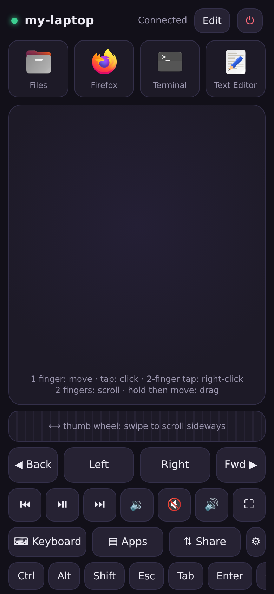
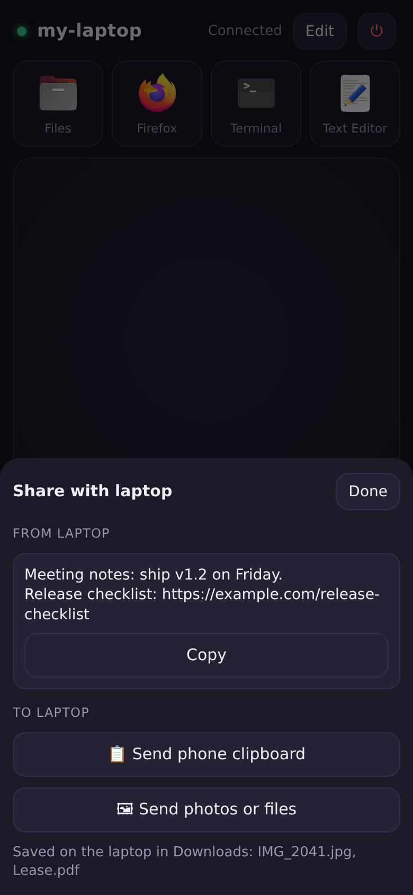

# Phone Remote

Control an Ubuntu laptop from your phone's browser over home Wi-Fi: trackpad, keyboard, media keys, app launchers, window switching, clipboard sync, file transfer and a safe shutdown button. No app to install on the phone; it runs as a Home Screen web app (tested on iPhone with Safari).

The laptop side is one small Python server (`aiohttp`) that fakes mouse and keyboard input through X11's XTest extension.

Use it when the laptop is plugged into a TV or monitor across the room: move the pointer, type, control playback, switch between open apps, pass links and photos back and forth, and shut the laptop down when you're done, all from the couch.

<p align="center">
  
  &nbsp;&nbsp;
  
</p>
<p align="center"><sub>Left: the remote. Right: the Share sheet, with text sent from the laptop by Alt+C.</sub></p>

## Features

- **Trackpad**: one finger moves, tap clicks, two-finger tap right-clicks, two fingers scroll, hold then move drags. A thumb-wheel strip scrolls sideways.
- **Mouse buttons**: Left, Right, Back and Forward.
- **Keyboard**: type with the phone keyboard (emoji and accents included), plus a row with Ctrl, Alt, Shift, Esc, Tab, Enter, Backspace and arrows.
- **Media keys**: previous, play/pause, next, volume down, mute, volume up, fullscreen.
- **App launchers**: four tiles for your favourite apps. Tap Edit to swap any tile for any installed app.
- **Open apps**: a list of open windows. Tap one to bring it to the front, or tap ✕ to close it.
- **Shut down**: closes every app the polite way (like clicking its ✕), waits up to 30 seconds, then powers off. If an app stays open, usually because it's asking "save changes?", the laptop does not power off; the phone tells you which app and offers "Shut down anyway".
- **Clipboard, laptop to phone**: select text or files on the laptop (or copy a picture) and press **Alt+C**. The phone shows it with Copy and Save buttons.
- **Clipboard, phone to laptop**: one tap sends the phone's clipboard (text or a picture) to the laptop clipboard; then press Ctrl+V.
- **Files, phone to laptop**: pick photos or files (iOS offers Photo Library, Camera and Files). They are saved in your Downloads folder.

## Requirements

- Ubuntu (tested on 22.04) with a **GNOME on Xorg** (X11) session. Wayland is not supported, because XTest input only works on X11. On the login screen, pick "Ubuntu on Xorg" from the gear menu.
- Python 3.10 or newer.
- The phone and the laptop on the same local network.

Install the dependencies:

```bash
sudo apt install python3-aiohttp python3-gi gir1.2-gtk-3.0 libxtst6 avahi-utils openssl libnotify-bin xdg-user-dirs
```

If your distribution's `python3-aiohttp` is too old, use `pip install --user aiohttp` instead.

## Install

```bash
git clone https://github.com/harshkchhajed/phone-remote.git
cd phone-remote
sh install.sh
```

`install.sh`:

1. copies the program to `~/.local/share/phone-remote`,
2. creates a systemd user service, `phone-remote.service`, that starts with your desktop session,
3. adds a GNOME keyboard shortcut, **Alt+C**, named "Send selection to phone (Phone Remote)",
4. starts the service.

Run it again after any change to the code. On the first start the server creates its own TLS certificates in `~/.config/phone-remote/tls/`.

If you use a firewall, allow your home network to reach port 8765, for example:

```bash
sudo ufw allow from 192.168.0.0/16 to any port 8765 proto tcp
```

## Set up the phone (once)

Phone browsers require HTTPS, so the server uses its own small certificate authority (CA). Trust it once:

1. On the phone, open `https://<laptop-hostname>-remote.local:8765/` in Safari. The server announces that name on the network over mDNS. You will see a "Not Private" warning the first time; continue anyway.
2. Tap **Download the certificate** and allow it. Then go to Settings → **Profile Downloaded** → Install.
3. Go to Settings → General → About → **Certificate Trust Settings** and turn on "Phone Remote CA".
4. Reload the page. The warning should be gone.
5. In Safari, tap Share → **Add to Home Screen**, and open "Laptop Remote" from the Home Screen. (Safari tabs and Home Screen apps keep separate logins, so pair from the Home Screen app.)
6. Tap **Pair**. A 6-digit code appears in a notification on the laptop. Type it on the phone.

After that, opening the Home Screen app connects automatically.

## Security

- **Pairing**: a device must type a 6-digit code shown only on the laptop screen. The code expires after 2 minutes and allows 5 tries. Each paired device gets a random token; the laptop stores only its SHA-256 hash, in `~/.config/phone-remote/devices.json`.
- **Every control action**, file download and upload requires a paired device's token.
- **The CA is name-constrained** to `.local`, `.lan`, `localhost` and private IP ranges. Even if its private key leaked, it could not be used to impersonate public websites. The CA key never leaves `~/.config/phone-remote/tls/` (mode 0700).
- The server is meant for a trusted home network. Do not expose port 8765 to the internet.

Manage paired devices:

```bash
python3 ~/.local/share/phone-remote/server.py --list-devices
python3 ~/.local/share/phone-remote/server.py --revoke-all
```

"Unpair this phone" in the phone's settings only forgets the token on the phone. To remove a device on the laptop, use `--revoke-all` and pair again.

## How it works

| File | Purpose |
|---|---|
| `server.py` | HTTPS and WebSocket server, pairing, app list, window list, shutdown, clipboard and file transfer, mDNS name. |
| `xinput.py` | Mouse, keyboard and window control through `libX11` and `libXtst` with `ctypes` (no extra Python packages). |
| `clip.py` | Reads and sets the X clipboard through GTK. A small helper process keeps the clipboard content until something else is copied. |
| `static/` | The phone web app (`index.html`), its icons and manifest. |
| `install.sh` | Installs the files, the systemd user service and the Alt+C shortcut. |

Details:

- **Input** goes over a WebSocket (`/ws`): `move`, `click`, `button`, `scroll`, `text`, `keys` and `launch` messages.
- **Windows** are listed and controlled with standard EWMH window-manager messages (`_NET_CLIENT_LIST`, `_NET_ACTIVE_WINDOW`, `_NET_CLOSE_WINDOW`).
- **Shutdown** uses `systemctl poweroff` once all windows have closed.
- **Alt+C**: the GNOME shortcut sends `SIGUSR1` to the service. The server waits for Alt to be released, presses Ctrl+C (Ctrl+Shift+C in terminals) in the focused app, reads the clipboard and pushes it to the phone.
- **Apps** come from the `.desktop` files in the usual application folders, including Flatpak and Snap ones. The four tiles are stored in `~/.config/phone-remote/slots.json`.

## Limitations

- X11 only (no Wayland).
- Alt+C is taken globally, so apps lose their own Alt+C shortcut (for example "match case" in VS Code's Find). Change the shortcut in GNOME Settings → Keyboard → Custom Shortcuts if you prefer another key.
- Folders cannot be sent from the laptop to the phone, only files.
- iOS lets a web page write to the clipboard or open the share sheet only during a tap, so laptop-to-phone items need one tap on Copy or Save.
- Only the most recent Alt+C item is kept, in memory. It is gone after a service restart.

## Troubleshooting

- **Phone can't connect**: check that both devices are on the same Wi-Fi and that VPNs are off. Check the service with `systemctl --user status phone-remote` and its log with `journalctl --user -u phone-remote -n 50`. If mDNS names don't resolve on your network, try `https://<laptop-hostname>.lan:8765/` or the laptop's IP address.
- **Input does nothing**: make sure you are in an Xorg session (`echo $XDG_SESSION_TYPE` should print `x11`).

## Uninstall

```bash
systemctl --user disable --now phone-remote.service
rm ~/.config/systemd/user/phone-remote.service
rm -r ~/.local/share/phone-remote
```

Remove the Alt+C shortcut in GNOME Settings → Keyboard → Custom Shortcuts. `~/.config/phone-remote` holds the certificates and paired devices; delete it to start fresh. On the phone, remove the "Phone Remote CA" profile in Settings → General → VPN & Device Management.

## License

[MIT](LICENSE)
